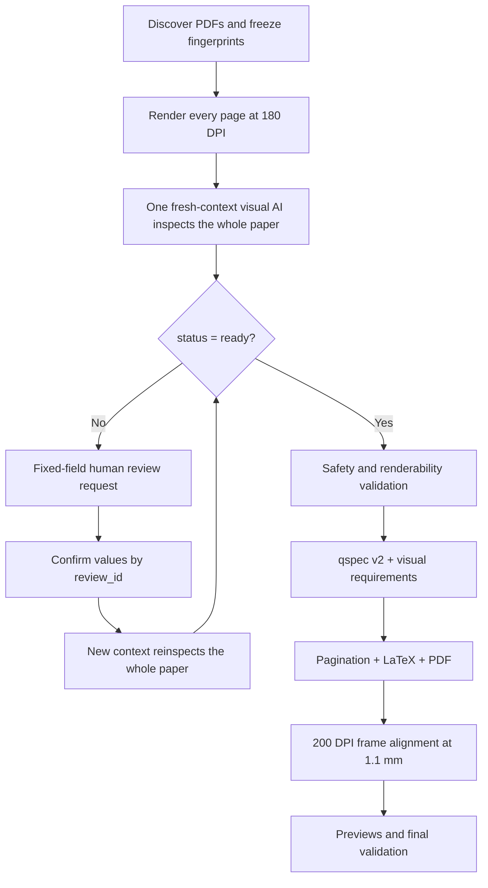

# Answer Card Skill v0.4.0

[简体中文](README.md)

This project generates blank, answer-free answer-card PDFs with Python, Jinja2, and XeLaTeX. v0.4.0 removes PDF text extraction, OCR, and regex-based number detection. One fresh-context visual AI worker inspects every page of one whole paper and returns structure, scores and percentages, answer-space layout, and prompt-visual requirements together.

> v0.4.0 has completed conflict-paper whole-document visual acceptance, A4 artifact checks, and automated regression testing. The visual AI must still be capable of inspecting every supplied page directly.

## Safety boundary

Reference-answer pages may be inspected only transiently for answer-free structure and answer-space shape. Formal and audit artifacts must never persist answers, solutions, reasoning, equation bodies, chemical structures, page-text excerpts, keywords, free evidence, or visual descriptions.

## Workflow



Scripts do not judge whether AI display numbers are duplicate, continuous, numerically sorted, or hierarchically plausible. qspec v2 creates unique machine keys such as `q001` and `q001-i001`; rendered cards print only the AI-authored `display_id`.

## Batch commands

```powershell
python scripts/batch_pipeline.py prepare INPUT OUTPUT_ROOT
python scripts/batch_pipeline.py status RUN\batch_manifest.json
python scripts/batch_pipeline.py accept-ai-paper RUN\batch_manifest.json PAPER_ID ATTEMPT_JSON
python scripts/batch_pipeline.py confirm-ai-paper RUN\batch_manifest.json PAPER_ID CONFIRMATION_JSON
python scripts/batch_pipeline.py build RUN\batch_manifest.json --paper PAPER_ID
python scripts/batch_pipeline.py report RUN\batch_manifest.json
```

The default remains three frame-alignment correction passes. A paper confirmed by answer-free measurements to be slowly convergent may use `build ... --max-alignment-passes 4`; the non-default limit is recorded in the task report and the `1.1mm` tolerance remains unchanged.

`prepare` discovers only first-level PDFs, freezes SHA-256 fingerprints, and renders stable `page-001.png` evidence at 180 DPI. It does not read PDF text, invoke OCR, or create outlines, skeletons, page transcripts, or number candidates.

Each visual worker may write only its job's `allowed_output_path`. Human review does not consume the single automatic invalid-output retry. A confirmation creates an immutable revision, and a new context must regenerate the complete paper result from all page images. The formal task report is written exactly once after every paper is `validated` or `failed`.

## Contracts and compatibility

`ai_paper_spec.json` is the only visual structure and layout authority. qspec v2 separates stable machine keys from display numbers. Visual manifests include both values, while prompt-image binding uses machine keys. Legacy qspec v1 and visual/binding manifests remain readable.

See [data contracts](docs/data-contracts.md) and [Codex batch orchestration](references/codex-batch-orchestration.md).

## Model and validation requirements

A model or trusted tool with direct page-image understanding is required for visual extraction. A text-only model may run deterministic stages but must not claim visual completion. GPT-5.5 and GPT-5.6 are development provenance, not vendor lock-in or compatibility guarantees.

The PDF path retains A4 output, whole-block pagination, centered bottom page numbers, preview rendering, and frame alignment. Alignment is measured at 200 DPI with a default tolerance of 1.1 mm.

The only supported test entry point is:

```powershell
python scripts/run_tests.py
```

It selects this worktree's `src`, uses a GUID-named OS temporary directory, and verifies cleanup.

License: [LICENSE](LICENSE).
