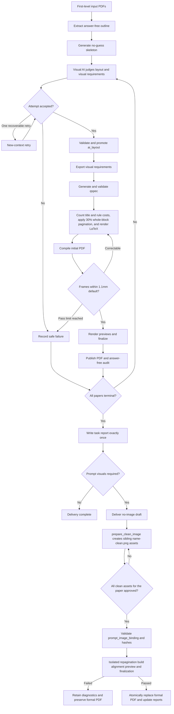

# answer-card-skill

[简体中文](README.md) | English

A blank answer-card generator for structured examinations such as chemistry competitions. It uses Python to maintain auditable data contracts, LaTeX to produce A4 PDFs, and separate stages for structure extraction, visual AI judgment, pagination, compilation, preview rendering, and final validation.

> [!IMPORTANT]
> Reference-answer PDFs may be used only to infer structure and answer-space needs. The project must never copy, paraphrase, persist, or output solution text, final answers, explanations, completed answer graphics, or other answer content.

## Highlights

- Process a directory of arbitrarily named first-level PDFs into blank answer cards.
- Keep an auditable intermediate layer through `outline.json`, `ai_layout.json`, and qspec.
- Probe all pages quickly with PyMuPDF, use `pypdf` only for text-bearing pages, and OCR only blank pages in memory while persisting only the answer-free `outline.json`.
- Generate blocks only for leaf item ids in a hierarchy, with schema guards against parent/descendant collisions.
- Use a visual-capable AI component to judge block layout, height, and prompt-side visual requirements.
- Render the first page, answer body, and page numbers deterministically with Jinja2 and XeLaTeX.
- Perform whole-block pagination, frame alignment, page preview rendering, and final artifact validation.
- Produce answer-free pipeline records and one task-level Markdown report.
- Stop first at a no-image draft when prompt visuals are required, create sibling clean assets through a deterministic CLI, then use a strict manifest for approved clean/original assets, cancellations, structural overrides, and fixed placements; publish only validated results atomically.

## Project status

The current version is `v0.3.0`. On 2026-08-06, three scanned PDFs known to lack extractable text completed the automatic OCR fallback and produced schema-valid structured JSON, while a PDF with an existing text layer stayed on the normal extraction path. An earlier real-paper end-to-end trial also passed the hierarchical-id fix, 12-page PDF build, previews, `1.1 mm` frame alignment, and final validation. Frame alignment remains measured at `200 DPI`. The repository is an operational engineering version with a usable Codex-hosted directory workflow, deterministic clean-image preparation, and audited post-approval image binding. See the [changelog](CHANGELOG.md) for versioned changes.

Auditable post-approval image binding is implemented. The main remaining work is to rerun the 19-paper validation set under the new `1.1 mm` frame-alignment default, harden interrupted-run recovery, broaden platform/model coverage, and finalize Skill packaging after the production contract stabilizes.

The detailed roadmap is maintained in Chinese in [the human/Agent interface roadmap](docs/dual-interface-roadmap.md).

## Quick start

### Requirements

- Python 3.11+
- XeLaTeX available on `PATH`
- Python dependencies declared in `pyproject.toml`
- PyMuPDF and `rapidocr-onnxruntime` are declared dependencies for previews and transient OCR
- A visual-capable model or trusted visual tool for AI layout judgment

Windows PowerShell example:

```powershell
git clone https://github.com/RayLuren/answer-card-skill.git
cd answer-card-skill
python -m venv .venv
.\.venv\Scripts\python -m pip install -e .
```

To process a directory through Codex, use a request such as:

```text
Use <local answer-card-skill project path>,
process the answer PDFs in <input directory>,
and write the results to <output root>.
```

The product entry point is `scripts/batch_pipeline.py`. It scans only first-level `*.pdf` files, assigns stable ids such as `paper001`, and creates a non-overwriting `run-*` directory. Codex-specific concurrency and retry behavior is defined in the [Codex batch orchestration contract](references/codex-batch-orchestration.md).

Build the bundled sample:

```powershell
.\.venv\Scripts\python scripts\build.py spec\qspec.sample.yaml
.\.venv\Scripts\python scripts\render_pages.py build\answercard.pdf build\pages
```

The detailed [getting-started guide](docs/getting-started.md) and [user guide](docs/user-guide.md) are currently maintained in Chinese.

## Workflow

The production flow is mostly linear. Visual reinspection and PDF frame alignment are the two controlled feedback loops.



See the Chinese [workflow guide](docs/workflow.md) for stage ownership and artifact flow.

## Main artifacts

| Artifact | Purpose |
| --- | --- |
| `outline.json` | Answer-free question hierarchy, scores, and page locations |
| `ai_layout.json` | Validated block layout and fixed visual classifications |
| `visual_requirements.json` | Deterministic projection of prompt-visual requirements |
| `qspec.draft.yaml` | Human-auditable answer-card specification |
| `prompt_image_binding.json` | Whole-paper clean/original assets, hashes, cancellations, structural overrides, and fixed placements |
| `qspec.binding.yaml` | Auditable adjusted copy; the original qspec remains unchanged |
| `answercard.tex` / `answercard.pdf` | LaTeX source and blank answer-card PDF |
| `pages/page-*.png` | Stable one-based final-page previews |
| `pipeline_report.json` | Per-paper answer-free validation record |
| `task-report.md` | The single user-facing task summary |

## Documentation

| Document | Scope |
| --- | --- |
| [Documentation index](docs/README.md) | Role-based navigation |
| [Getting started](docs/getting-started.md) | Installation and first build |
| [User guide](docs/user-guide.md) | Single-paper, batch, recovery, and image follow-up workflows |
| [Workflow](docs/workflow.md) | Stage responsibilities and artifact flow |
| [Data contracts](docs/data-contracts.md) | outline, AI layout, visual requirements, and qspec |
| [Validation and reporting](docs/validation-and-reporting.md) | Alignment, finalization, timing, and reports |
| [Development](docs/development.md) | Repository layout, tests, and engineering boundaries |
| [Changelog](CHANGELOG.md) | Versions, release dates, and user-visible changes |
| [Roadmap](docs/dual-interface-roadmap.md) | Human and Agent interface roadmap |
| [Codex orchestration contract](references/codex-batch-orchestration.md) | Worker, concurrency, acceptance, and retry rules |

Detailed documentation is Chinese-first. Paths and machine-facing contracts remain stable and use English identifiers where appropriate.

## Safety boundary

Persisted data is limited to approved structural metadata such as problem ids, section boundaries, problem types, major-problem scores, page locations, space estimates, and fixed labels. Answer content is forbidden in generated LaTeX, PDFs, JSON, YAML, logs, tests, fixtures, snapshots, and documentation.

Never crop or reconstruct a clean prompt asset from a completed answer-key graphic. If prompt-side origin is unclear, classify it as `uncertain` and later use only a question paper or another human-approved prompt-side source.

## Development and tests

Run tests only through the supported wrapper:

```powershell
.\.venv\Scripts\python scripts\run_tests.py
```

It creates an isolated operating-system temporary directory for each pytest run and makes cleanup failures visible. See [CONTRIBUTING.md](CONTRIBUTING.md) before contributing code.

## Models and platforms

The deterministic Python, schema, LaTeX, build, and preview stages are vendor-neutral. AI layout judgment requires a real visual-inspection path; a text-only model must not claim that this stage is complete.

GPT-5.5 and GPT-5.6 were used during development. This is provenance, not a vendor requirement or compatibility guarantee.

## License

This project is licensed under the [MIT License](LICENSE).
