# answer-card-skill

Reusable Python/LaTeX project for generating blank chemistry competition answer cards.

The project uses a human-reviewable structured spec layer between source inspection and final PDF output. Reference-answer PDFs are used only to infer answer-card structure, never to reproduce answer content.

## Safety Rule

Never leak reference-answer content.

Reference-answer PDFs may be inspected only to derive structural metadata and answer-space needs. AI layout judgment may read source pages transiently to understand the expected answer shape, but answer content must never be persisted or repeated.

- problem numbers
- section boundaries
- problem types
- major-problem point values
- estimated answer-space needs

Do not copy, summarize, paraphrase, render, store, or test against solution text, final answers, explanations, or answer keys in generated LaTeX, PDFs, logs, fixtures, snapshots, or docs.

## Codex Product Entry

The v1 product host is Codex CLI. A user can start a new session with one request:

```text
调用 D:\Work\answer-card\answer-card-skill，
处理 <输入目录> 下的答案 PDF，
输出到 <输出根目录>。
```

The product scans only first-level `*.pdf` files, accepts arbitrary filenames, assigns stable internal ids `paper001`, `paper002`, and so on, and creates a new non-overwriting `run-*` directory. Codex schedules one fresh-context visual worker per whole paper with bounded cross-paper concurrency; each accepted paper enters the deterministic build immediately while local XeLaTeX builds remain serial. See [`references/codex-batch-orchestration.md`](references/codex-batch-orchestration.md).

## Project Shape

- Python package: `src/answercard`
- CLI helper scripts: `scripts`
- LaTeX template: `tex/main.tex.j2`
- Skill-owned first-page template: `tex/front_page.tex.j2`
- Skill-owned first-page artwork: `assets/periodic-table.png`
- Structured specs: `spec`
- Fixtures: `fixtures`
- Tests: `tests`
- Generated outputs: `build`
- Fixed AI layout prompt: `prompts/ai_layout_judge.md`
- Codex batch orchestration contract: `references/codex-batch-orchestration.md`
- Batch manifest/state/job contracts: `src/answercard/batch.py`

The preferred intermediate representation is an auditable YAML/spec layer. Extraction, schema validation, layout decisions, LaTeX rendering, PDF build, and preview rendering are kept separate.

## Current Capabilities

- Validate qspec YAML through typed schema objects in `src/answercard/schema.py`.
- Maintain a valid hand-authored MVP sample at `spec/qspec.sample.yaml`.
- Render qspec files deterministically to LaTeX with `src/answercard/render_tex.py` and `tex/main.tex.j2`.
- Render a centered Arabic page number at the bottom of every final page, including the first page. Page-number digits reuse `\QuestionTitleFont`, so their font, size, and weight match the question-number and score digits in major-question headings.
- Render the accepted black-and-white first page from `tex/front_page.tex.j2`; its title, question columns, raw scores, assigned percentages, and totals are generated mechanically from validated qspec data.
- Build a PDF pipeline through `scripts/build.py`, which writes `build/answercard.tex`, runs `xelatex`, and expects `build/answercard.pdf`.
- Render PDF pages into stable one-based PNG previews such as `build/pages/page-001.png`.
- Extract structural outline metadata from a reference-answer PDF into `build/outline.json`.
- Generate `build/ai_layout.skeleton.json` deterministically from the outline so the visual AI cannot alter question ids, item ids, order, or scores.
- Require AI-authored layout judgment in `build/ai_layout.json` for the full pipeline.
- Classify every AI-layout item in the same inspection as one of seven fixed visual-requirement categories, without a second AI pass or a second PDF text-extraction path.
- Export the answer-free decisions deterministically to `build/visual_requirements.json`, including a derived `requires_preprinted_visual` value.
- Surface every required preprinted-visual and uncertain item in the user-facing task Markdown; missing detail produces a warning rather than a silent zero.
- Post-process user-supplied approved prompt images with the template-owned `\AnswerImageRow`, preserving block height, keeping `0.6mm` vertical clearance on each side, and centering on the A4 page before direct XeLaTeX recompilation.
- Convert `build/outline.json` plus `build/ai_layout.json` into a schema-valid draft qspec at `spec/qspec.draft.yaml`.
- Validate AI layout output so each question explicitly carries visually read `score`, printed `percent`, and `percent_source` without silently correcting source discrepancies. Enforce exact outline item-id coverage, positive kind-specific height ranges, compatible visual classifications, and the fixed second-inspection fallback contract. Redundant evidence labels and numeric confidence fields are intentionally excluded.
- Run a deterministic validation gate with `scripts/finalize_pipeline.py`: validate the PDF and supporting artifacts, record per-stage timing, and always clean declared temporary evidence. Successful builds retain audit artifacts by default; pruning is an explicit packaging option.
- Reject finalization when the generated LaTeX no longer contains the required centered page-number style or no longer renders page numbers with `\QuestionTitleFont`.
- Maintain one wall-clock report across Agent and script work with `src/answercard/pipeline_timing.py` and `scripts/pipeline_timer.py`; deterministic pipeline stages append automatically, while AI inspection uses explicit start/stop markers.
- Generate one user-facing task Markdown with `scripts/write_task_report.py`; it aggregates one or more completed or terminally failed pipeline reports, lists every stage duration and required visual item, and prominently calls out AI-layout/outline conflicts, non-100 percentage totals, second-inspection `unknown` long-box fallbacks, retries, missing detail, or non-default alignment settings.
- Run resumable directory batches through `scripts/batch_pipeline.py` with immutable source fingerprints, strict attempt jobs, atomic state updates, one fresh-context retry, serial deterministic builds, root-level PDF publication, per-paper audit/failure archives, and one idempotent task report.

## Current Work Status and TODO

The standalone first-page prototype in the workspace-level `wordcom-to-xeletax/` folder remains the accepted visual baseline. Its layout and periodic-table artwork have been migrated into the Skill, and one real-paper integrated first-page/body build has been completed. Keep the original prototype intact until broader visual regression testing is complete.

### Completed or Currently Usable

- The Skill-owned first page and generated answer-card body compile as one coordinated PDF. The first real-paper build is complete; the remaining work is broader regression testing rather than initial migration.
- The AI layout inspection classifies every item into the fixed seven-class visual-requirement system during the same inspection. It does not require a second AI pass or a separate text-extraction path.
- `visual_requirements.json`, `pipeline_report.json`, and the task-level Markdown report carry answer-free required-visual and uncertain item ids. The report always contains `答题卡配图需求` and warns when required detail is missing.
- Approved prompt-side images can be placed manually with `\AnswerImageRow`. The current rule preserves block height, leaves `0.6mm` vertical clearance on each side, centers the image on the A4 page, and recompiles without rerunning extraction or AI judgment. This mechanism has passed one real-paper image-placement test.
- The supported test entry creates one GUID-named operating-system temporary directory and removes it after passing or failing runs; cleanup failure is reported as a test failure.

### Remaining TODO

| Area | Status | Remaining work |
| --- | --- | --- |
| Clean publication history | Complete | The private GitHub repository uses a fresh `main` root commit containing only reviewed reusable project files. Legacy history remains local-only and is never pushed. |
| Automatic prompt-image binding | Not implemented | Add an auditable asset manifest keyed by block id, validate it against `visual_requirements.json`, replace only the matching answer rows, compile the image-bearing PDF, record embedded ids, and regenerate the task report. Keep this as a controlled post-processing stage outside qspec v1. |
| Real-paper forward testing | In progress | Test more papers and cover `modify_existing_visual`, `complete_existing_visual`, `draw_on_scaffold`, multiple images in one paper, uncertain cases, and unusually wide, tall, or white-bordered assets. |
| Engineering workflow versus packaged Skill | In progress | Run both interfaces against the same accepted inputs and document functional, visual, operational, and reporting differences. |
| Human/Agent interface architecture | Awaiting review | Review [`docs/dual-interface-roadmap.md`](docs/dual-interface-roadmap.md), confirm or revise its proposed architecture, then add `references/change-routing.md`. |
| Optional minor-score factor | Not started | Decide whether minor scores are display-only or participate in totals before changing schema, validation, rendering, or reports. Never derive them from reference-answer body content. |
| Stable Skill packaging | Engineering draft | Finalize the Skill contract, frontmatter, references, preflight behavior, and validation only after the production workflow is stable. |
| Cross-platform and model/backend compatibility | Partial | Preserve the deterministic vendor-neutral core, then validate additional Agent Skills hosts, operating systems, visual-capable models, and API backends. |

### Recommended Execution Priority

1. Implement the deterministic prompt-image binding stage with a small asset manifest and focused tests. The initial no-image pipeline remains unchanged; image binding occurs only after human approval.
2. Forward-test the full no-image/report/image-placement workflow on several real papers, including all three preprinted-visual classes and uncertain cases.
3. Cross-validate the engineering workflow and packaged Skill, and record the remaining differences.
4. Review the dual-interface roadmap and create `references/change-routing.md` before building a new user interface or broad customization layer.
5. Define and, if approved, implement the optional minor-score factor.
6. Finalize Skill packaging, then broaden cross-platform and model/backend validation.

## AI Agent and Model Requirements

The deterministic Python, schema, LaTeX, PDF-build, and preview stages are not tied to a specific model vendor. The host Agent must be able to read and write project files, run the documented local commands, and follow the structured JSON/YAML contracts.

The AI layout judgment stage has an additional requirement: the Agent must either use a model with sufficient visual understanding to inspect rendered reference-PDF pages or have access to a trusted visual-capable tool/model. A text-only backend may run the deterministic stages, but it must not claim that `build/ai_layout.json` has received the required visual judgment unless a visual-capable component actually inspected the transient page evidence.

GPT-5.5 and GPT-5.6 were used by the author while developing this Skill. This records the authoring environment rather than imposing a model requirement. Other Agents and model APIs may be used when they provide the required filesystem, command-execution, structured-output, and visual-inspection capabilities and pass the same schema, safety, artifact, and visual acceptance checks.

## GitHub Publication Status

The private repository is `RayLuren/answer-card-skill`. Its published `main` starts from a fresh root commit containing reviewed source code, tests, templates, prompts, the hand-authored sample spec, Skill metadata, and documentation.

The local legacy backup still contains earlier commits that tracked files which must never be published:

- `fixtures/reference_answer.pdf`
- `fixtures/template_answer_sheet.docx`
- `src/answer_card_skill.egg-info/`

Never push the legacy backup or use `git push --all`. Generated draft/per-paper specs, reference-answer fixtures, transient AI evidence, virtual environments, build outputs, caches, and generated package metadata remain local-only and ignored.

## Data Flow

The workflow is mostly linear. AI evidence re-inspection and final PDF frame alignment are the two controlled feedback loops. This diagram is maintained as Mermaid source so it stays reviewable and versioned with the implementation.

```mermaid
flowchart TD
    A[Input directory: first-level PDFs] --> PREP[prepare immutable manifest and atomic state]
    PREP --> C[Per-paper outline and no-guess skeleton]
    C --> D[Strict ai_layout_job attempt 1]
    D --> QUEUE[Bounded whole-paper visual queue]
    QUEUE --> E[Fresh-context worker jointly judges layout and visual requirement]
    E --> F{Kind resolved?}
    F -- First unknown --> G[Re-inspect original page evidence once]
    G --> E
    F -- Still unknown --> FALLBACK[Use unknown + 95mm conservative fallback]
    F -- Yes --> AT[ai_layout.attempt-N.json]
    FALLBACK --> AT
    AT --> ACCEPT{accept-ai-layout passes?}
    ACCEPT -- Recoverable attempt 1 failure --> RETRY[Close thread and create fresh attempt 2]
    RETRY --> QUEUE
    ACCEPT -- Second or unrecoverable failure --> CONFLICT[Archive failed paper]
    ACCEPT -- Yes --> H[Atomically promote formal ai_layout.json]
    H --> AUDIT{Conflicts with outline?}
    AUDIT -- Yes --> CONFLICT[Record conflict and stop this paper]
    AUDIT -- No --> AA[Export build/visual_requirements.json]
    AA --> I{AI layout schema valid?}
    I -- No --> G
    I -- Yes --> J[spec/qspec.draft.yaml]
    J --> K{qspec schema valid?}
    K -- No --> E
    K -- Yes --> L[Build first-page score-table view from qspec]
    K -- Yes --> W[Whole-block pagination and threshold rules]
    L --> M[Render Skill-owned first page and body]
    W --> M
    M --> X[build/answercard.tex]
    X --> N[Compile initial PDF]
    N --> O[Scan horizontal frame pixels]
    O --> P{Non-final page edges within tolerance?}
    P -- No, up to pass limit --> Q[Adjust page spacing]
    Q --> X
    P -- Yes --> R[build/answercard.pdf]
    R --> S[Render page PNG previews]
    S --> T[Final validation and pipeline report]
    T --> U[Clean temporary evidence]
    U --> V[Retain audit artifacts by default]
    V --> PUB[Atomically publish PDF at run root and archive audit]
    PUB --> TERM{All papers validated or failed?}
    CONFLICT --> TERM
    TERM -- No --> QUEUE
    TERM -- Yes --> Y[Write task-report.md and run-report.json exactly once]
    Y --> VA{Required or uncertain visual items?}
    VA -- No --> VD[Delivery complete]
    VA -- Yes --> VB[Report item ids and stop at no-image draft]
    VB --> VC[User supplies approved prompt-side images]
    VC --> VE[Replace matching AnswerRow with AnswerImageRow]
    VE --> VF[Compile TeX directly and inspect previews]
    VF --> VG[Update report status to embedded]
```



The extracted outline is structural only. It is not a qspec and must not contain answer body text or per-subquestion scores.

`build/ai_layout.json` is also structural only. It is produced by applying `prompts/ai_layout_judge.md` to the outline and transient inspection of the reference PDF. The same per-item inspection decides layout and visual requirements; it does not run a second AI screening pass. Rendered reference-answer page images or extracted page text may be used under `.tmp/` during AI inspection, but they must not be retained after `ai_layout.json` passes validation.

`build/visual_requirements.json` is a deterministic projection of validated AI-layout fields. It contains only ids, fixed classification labels, and the derived preprinted-visual state. It never contains numeric confidence, matched text, keyword hits, snippets, reasons, visual descriptions, or answer content.

### Initial No-Image Build and Manual-Asset Follow-Up

The current automated pipeline always compiles the no-image initial answer card first. Finalization copies the answer-free ids and fixed classifications for every `requires_preprinted_visual: true` or `uncertain` item into `pipeline_report.json`. The task-level Markdown must always render those details in a `答题卡配图需求` section; if item details are missing, it displays a warning instead of treating the paper as having no visual requirements.

When preprinted visuals are required, the initial PDF remains an explicit draft. The user then places approved prompt-side images in a separately managed directory and supplies the files or paths. The Agent edits only the existing `build/answercard.tex`, replacing the matching `\AnswerRow{id}{height}` with `\AnswerImageRow{id}{height}{path}`, and compiles directly from `build/` without rerunning extraction, AI judgment, qspec generation, pagination, or the full pipeline.

`\AnswerImageRow` is defined in `tex/main.tex.j2`. It preserves the original block height and image aspect ratio, leaves `0.6mm` above and below the image canvas, limits width so the image stays in the answer body, and horizontally centers the image on the A4 page rather than the answer-body cell. After compilation, render all previews, inspect each modified page and adjacent pages, update the structural report status to `embedded`, and regenerate the task Markdown. Automated asset manifests and automatic row replacement remain future work. Do not crop or reconstruct clean prompt assets from completed answer-key graphics.

Example row replacement:

```latex
% Before
\AnswerRow{7-3-1}{47.3mm}

% After
\AnswerImageRow{7-3-1}{47.3mm}{../../images/38-23/7-3-1.png}
```

Compile and preview without rerunning the earlier pipeline:

```powershell
cd build
xelatex -interaction=nonstopmode -halt-on-error answercard.tex
cd ..
.\.venv\Scripts\python scripts\render_pages.py build\answercard.pdf build\pages
```

### Stage and File Map

| Stage | Responsibility | Main files |
| --- | --- | --- |
| Structure extraction | Identify question hierarchy, major-question score, and source pages without retaining answers | `src/answercard/extract_outline.py`, `scripts/extract_outline.py` |
| AI skeleton preparation | Lock outline question/item ids, order, and scores without guessing any visual decision | `src/answercard/ai_layout_skeleton.py`, `scripts/prepare_ai_layout_skeleton.py`, `build/ai_layout.skeleton.json` |
| AI job preparation | Lock prompt, outline, skeleton, source evidence, attempt id, and the single allowed attempt output in strict JSON | `src/answercard/batch.py`, `ai_layout_job.attempt-N.json` |
| AI layout validation | Require explicit percentage source, exact id coverage, positive kind-specific heights, compatible visual fields, and the fixed unknown fallback; reject evidence-shape and confidence fields | `src/answercard/ai_layout_schema.py`, `src/answercard/ai_layout_audit.py` |
| Visual requirement export | Project fixed visual classifications and derive whether a preprinted prompt visual is required | `src/answercard/visual_requirements.py`, `scripts/export_visual_requirements.py`, `build/visual_requirements.json` |
| qspec generation and validation | Merge outline and AI decisions into the auditable layout specification | `src/answercard/ai_layout_to_qspec.py`, `src/answercard/schema.py` |
| Pagination | Apply whole-block pagination and threshold-percentage fit rules without splitting blocks | `src/answercard/layout.py` |
| First-page rendering | Build a dynamic score-table view from qspec and render the Skill-owned cover without answer content | `src/answercard/render_tex.py`, `tex/front_page.tex.j2`, `assets/periodic-table.png` |
| LaTeX rendering | Combine the optional first page and planned answer-card body into one LaTeX document | `src/answercard/render_tex.py`, `tex/main.tex.j2` |
| PDF compilation | Run XeLaTeX and expose build failures through `build/build.log` | `scripts/build.py` |
| Frame alignment | Scan the first and last qualifying horizontal dark rows, adjust page spacing, and recompile when needed | `src/answercard/frame_alignment.py`, `build/frame_alignment.json` |
| Preview and sanity checks | Render stable one-based PNG previews and validate final artifacts | `scripts/render_pages.py`, `scripts/full_pipeline.py` |
| Validation gate | Check page count, A4 geometry, schema, sensitive phrases, compilation logs, alignment, and preview count; always clean temp evidence and retain audit artifacts unless packaging explicitly requests pruning | `scripts/finalize_pipeline.py`, `build/pipeline_report.json` |
| Task report | Aggregate all per-paper reports into exactly one user-facing Markdown report, including structural conflicts, non-100 totals, unknown long-box fallbacks, required/uncertain visual item ids, and initial-draft status | `src/answercard/task_report.py`, `scripts/write_task_report.py`, `build/task-report.md` |

`scripts/full_pipeline.py` is the canonical orchestration entry after `build/ai_layout.json` exists. A safe formal paper title must be supplied with `--paper-title`; the title is stored in qspec rather than inferred from the reference-answer filename. The coordinated build includes the first page by default and always enables body-frame alignment. Use `--omit-front-page` only for a deliberate body-only build. Direct `scripts/build.py` calls compile without alignment unless `--align-pages` is supplied.

## AI Layout Contract

Use `prompts/ai_layout_judge.md` as the fixed prompt for the AI judgment step. First generate `ai_layout.skeleton.json` from the outline; it locks ids, order, and scores but contains no candidate kind, height, percentage, or visual classification. Run the production visual judgment in a fresh narrow context without earlier layout conclusions. During one per-item inspection, the AI fills the skeleton's decision slots using direct visual PDF access or original per-page images; page text is optional locating assistance only. Do not generate or use contact sheets.

The current Codex handoff and concurrency contract is [`references/codex-batch-orchestration.md`](references/codex-batch-orchestration.md). The older Markdown handoff audit in `docs/ai-layout-subagent-handoff-audit.md` is historical and is not part of the production contract.

Allowed block kinds are:

- `short_answer`
- `formula`
- `equation`
- `calculation`
- `drawing`
- `mechanism`
- `table`
- `multi_step`
- `long_explanation`
- `mixed`
- `unknown`, only after one explicit second visual inspection and only with the fixed fallback below

The contract contains no redundant evidence-label field. If the first kind judgment is unknown, the item must receive one explicit reinspection of the original page evidence or source PDF. If the second judgment remains unknown, the final AI layout must use exactly `kind: unknown`, `height: 95mm`, and `fallback_after_reinspection: true`. qspec conversion renders that item as a `mixed` 95mm block while `pipeline_report.json` and the task Markdown retain and prominently identify the original fallback. Resolved kinds use `fallback_after_reinspection: false` and a positive height inside their fixed prompt range.

Every question must explicitly output `percent_source`; omission is an error. The actual printed percentage total is never forced to 100. A non-100 total is retained and prominently reported. AI output is audited against outline before qspec conversion; question-id, item-id, score, or previously extracted percentage conflicts are written to the pipeline report and stop the build rather than being silently reconciled.

Every item must use one visual-requirement category:

- `modify_existing_visual`
- `complete_existing_visual`
- `draw_on_scaffold`
- `draw_from_scratch`
- `visual_reference_only`
- `no_visual`
- `uncertain`

Only the first three require a preprinted prompt-side visual. `uncertain` is retained for later visual review and produces a `null` derived preprint decision. `visual_type` is also a fixed enum covering chemical structures, diagrams, coordinate systems, tables, grids, reaction frameworks, flowcharts, apparatus, other, none, and uncertain. A completed answer-key graphic must never be treated as a clean prompt scaffold; actual visual acquisition remains a later question-paper-side task.

## qspec Contract

Current qspec data includes:

- `schema_version: 1`
- `paper`
- `paper.title`
- `paper.omit_front_page`
- `paper.total_score`
- `style`
- `questions`
- `blocks`

Schema objects include `PaperSpec`, `StyleSpec`, `QuestionSpec`, `BlockSpec`, and `AnswerCardSpec`.

`load_spec(path)` loads YAML and calls `validate_spec(data)` before returning typed spec objects. qspec v1 is strict: unknown fields are rejected rather than ignored.

Each question requires `id`, `title`, a positive `score`, an integer `percent`, and at least one block. `paper.total_score` must equal the sum of question scores. Printed whole-number percentages are preserved exactly even when independent rounding or a publication error makes their total differ from 100; final reports display and flag the actual total. In the preferred AI path, `score`, `percent`, and `percent_source` are stored in `ai_layout.json`. Use `percent_source: printed` when the heading contains a visible percentage. If a heading truly omits percentages, allocate them deterministically from all major-question scores with the largest-remainder method, mark the affected questions `derived`, and list them in the task report.

`paper.title` is an explicit pipeline input and the sole source of the rendered first-page title. It must not be inferred from `outline.source` or a reference-answer filename. The first-page score table maps `questions[].id` to the question headers, `questions[].score` to `原始分`, `questions[].percent` to `赋分`, and `paper.total_score` to the raw-score total; the assigned total prints the actual sum of the visually read whole-number percentages, and the `得分` row remains blank.

Question ids must be unique positive-integer strings. A question with one whole answer area and no printed subitem may use the major-question id itself as its sole block id, so the left label can display `2` rather than an invented `2-1`. Real subitems keep numeric hyphen-separated ids beginning with their owning question id. Block `kind` must be one of the AI-layout approved kinds. Dimensions must be positive and include `mm` or `pt`.

Legacy free-text fields such as `raw_heading` and block `note` are not part of qspec v1. Missing `height`, misspelled `hight`, `unknown` kinds, missing percentages, inconsistent totals, duplicate ids, and unsupported fields all fail validation.

Blocks contain only answer-card layout metadata: `id`, `kind`, `height`, and optional `force_page_break_before`. They must not contain reference-answer content.

## Outline Contract

The reference-answer outline extractor may use PDF text extraction only to identify structure. It writes only:

- `source`
- `questions[].id`
- `questions[].title`
- `questions[].score`
- `questions[].page`
- `questions[].items[]`
- `questions[].items[].id`
- `questions[].items[].page`

`questions[].score` is the major-problem score. Per-item or subquestion scores are intentionally excluded.

The extractor filters false subitem ids from numeric and scientific-notation contexts such as `x 10-4` and `10-12.67`.

Use `scripts/prepare_ai_layout_skeleton.py` immediately after extraction. The visual AI may fill only the empty decision fields and must not change the skeleton structure. Validate each paper immediately after its AI output is written; do not wait until the end of a batch to discover structural or schema failures.

## Commands

Run tests:

```powershell
.\.venv\Scripts\python scripts\run_tests.py
```

`scripts/run_tests.py` 每次在操作系统临时目录下创建全新的 GUID 目录，并在 `finally` 路径中删除它：测试成功或失败都会清理；如果清理失败，命令本身会明确失败并报告残留路径。不要把 pytest `--basetemp` 指向 `build/`、项目内的 `.tmp/`，也不要复用 pytest 的默认共享临时目录。

Windows 上允许工程与系统临时目录位于不同盘符。例如工程在 `D:`、测试目录在 `C:` 时，LaTeX 渲染器会对首页资源使用绝对正斜杠路径；同盘输出仍使用相对路径。该兼容行为由测试覆盖。

Render the sample qspec to LaTeX:

```powershell
.\.venv\Scripts\python scripts\render_tex.py spec\qspec.sample.yaml build\answercard.tex
```

Build the sample PDF pipeline:

```powershell
.\.venv\Scripts\python scripts\build.py spec\qspec.sample.yaml
```

Use `--build-dir` for an isolated preview build that must not replace the canonical `build` artifacts.

Render PDF page previews:

```powershell
.\.venv\Scripts\python scripts\render_pages.py build\answercard.pdf build\pages
```

Extract a reference-answer PDF outline:

```powershell
.\.venv\Scripts\python scripts\extract_outline.py fixtures\reference_answer.pdf build\outline.json
```

Generate the no-guess AI layout skeleton:

```powershell
.\.venv\Scripts\python scripts\prepare_ai_layout_skeleton.py build\outline.json build\ai_layout.skeleton.json
```

Generate a draft qspec from AI layout judgment:

```powershell
.\.venv\Scripts\python scripts\ai_layout_to_qspec.py `
  build\outline.json `
  build\ai_layout.json `
  spec\qspec.draft.yaml `
  --paper-title "正式试卷标题答题卡"
```

Export visual requirements directly when running the deterministic step separately:

```powershell
.\.venv\Scripts\python scripts\export_visual_requirements.py `
  build\ai_layout.json `
  build\visual_requirements.json
```

Run the full pipeline after `build\ai_layout.json` exists:

```powershell
.\.venv\Scripts\python scripts\full_pipeline.py `
  fixtures\reference_answer.pdf `
  --paper-title "正式试卷标题答题卡"
```

If a reviewed exception requires changing frame-alignment behavior, pass `--alignment-tolerance-mm` or `--max-alignment-passes` explicitly. The selected value and its default are stored in the pipeline report and surfaced in the final task Markdown. Use the same tolerance again when invoking `scripts/finalize_pipeline.py`.

Run the final delivery gate after the final PDF and previews exist. Use `--front-pages 1` when one cover page has been prepended. Repeat `--temp-path` for every transient reference-page or conversion-copy path:

```powershell
.\.venv\Scripts\python scripts\finalize_pipeline.py `
  --front-pages 1 `
  --temp-path .tmp\source-pages `
  --temp-path .tmp\front-page-work
```

The finalizer performs these checks without deleting ordinary audit artifacts:

- qspec loads through the strict schema.
- `visual_requirements.json` loads through its strict schema and exactly covers every qspec block id.
- PDF page count equals qspec-planned body pages plus `--front-pages`.
- Every final PDF page is A4.
- Extracted final PDF text does not contain blocked answer-key phrases.
- At least one compilation log exists and contains no blocked fatal, emergency, LaTeX, or overfull-vbox marker.
- The final frame-alignment pass covers every body page and stays within the configured tolerance.
- Preview files are non-empty, consecutively named, and exactly match the final PDF page count.

Temporary paths are accepted only below `.tmp` and are removed in a `finally` path whether validation passes or fails. On success, audit artifacts such as `outline.json`, `ai_layout.json`, qspec, LaTeX, logs, visual requirements, alignment measurements, reports, PDFs, and previews remain available. Use `--prune-on-success` only for an explicit packaging step that intentionally reduces a copied delivery directory. On failure, diagnostics remain available while declared temporary evidence is still removed.

`build/pipeline_report.json` records stage status and duration, expected and actual page counts, preview count, final alignment spread, the actual alignment tolerance, the default alignment tolerance, and the configured maximum alignment passes. It contains structural diagnostics only, never reference-answer content.

## Pipeline Timing

Start the clock once before beginning a new paper:

```powershell
.\.venv\Scripts\python scripts\pipeline_timer.py begin --label "paper-name"
```

Agent-owned work such as visual source inspection is timed explicitly:

```powershell
.\.venv\Scripts\python scripts\pipeline_timer.py start ai_layout_judgment
# Inspect transient PDF evidence and produce a validated AI layout.
.\.venv\Scripts\python scripts\pipeline_timer.py stop ai_layout_judgment
```

`scripts/full_pipeline.py` automatically appends its extraction, deterministic visual-requirement export, qspec conversion, PDF build/alignment, preview rendering, and sanity-check stages to the same report. `scripts/finalize_pipeline.py` appends final validation and temporary cleanup, records whether optional pruning occurred, and closes the current validation run with `finished_at` and `total_duration_seconds`.

Show a concise text summary at any point:

```powershell
.\.venv\Scripts\python scripts\pipeline_timer.py summary
```

The report uses wall-clock elapsed time, so AI-stage durations include image loading and tool waits. It does not claim to measure private model reasoning time. Timing occurs only at major stage boundaries and requires a small atomic JSON write, so its runtime overhead is negligible compared with PDF rendering, AI inspection, and XeLaTeX compilation.

## Task-Level Markdown Report

Generate the Markdown report only after every PDF in the current user task has either passed finalization or recorded a terminal safe failure. A single-paper task and a batch task both produce exactly one Markdown file.

For one paper:

```powershell
.\.venv\Scripts\python scripts\write_task_report.py `
  build\paper01\pipeline_report.json `
  --output build\task-report.md
```

For multiple papers, keep one pipeline JSON per paper and pass all of them to one invocation:

```powershell
.\.venv\Scripts\python scripts\write_task_report.py `
  build\paper01\pipeline_report.json `
  build\paper02\pipeline_report.json `
  build\paper03\pipeline_report.json `
  --output build\task-report.md
```

The Markdown contains each paper's full stage-duration table, total wall-clock duration, final page and alignment results, failed/retry stages, and parameter deviations. If alignment tolerance changes from the default `0.7 mm`, or the maximum alignment-pass limit changes from its default, the report explicitly prints the default and actual values. It does not include source-PDF paths or reference-answer content.

## Codex-Managed Batch Workspace

`prepare INPUT OUTPUT_ROOT` discovers only first-level PDFs and creates `run-YYYYMMDD-HHMMSS-<input-slug>/`; a same-second collision receives `-02`, `-03`, and so on. The output root must not be inside the input directory. A normal invocation never overwrites an earlier run; resume by explicitly referencing an existing manifest.

Default titles remove a trailing `参考答案`, `答案`, or `详解` plus adjacent separators from the filename stem, then append `答题卡`. An optional input-side `answercard-batch.yaml` can override `title` and `output_name`:

```yaml
schema_version: 1
papers:
  任意文件名.pdf:
    title: 定制答题卡标题
    output_name: 定制输出.pdf
```

Unknown files or fields, invalid mappings, and duplicate explicit output names are rejected. Automatic name collisions receive `-paperNNN`; explicit duplicates are configuration errors. The immutable manifest records each filename, byte size, and SHA-256, so resume cannot silently use a replaced source.

```text
run-YYYYMMDD-HHMMSS-input/
├─ 成功卷答题卡.pdf
├─ task-report.md
├─ run-report.json
├─ batch_manifest.json
├─ batch_state.json
├─ audit/paper001/
├─ failed/paper002/
└─ .work/
```

Successful PDFs are published only at the run root after final validation; answer-free audit artifacts move to `audit/`, while failed workspaces and safe diagnostics move to `failed/`. Transient source pages are always removed for terminal papers.

Stable commands:

```powershell
.\.venv\Scripts\python scripts\batch_pipeline.py prepare INPUT OUTPUT_ROOT [--metadata INPUT\answercard-batch.yaml] [--visual-workers N]
.\.venv\Scripts\python scripts\batch_pipeline.py status RUN\batch_manifest.json
.\.venv\Scripts\python scripts\batch_pipeline.py accept-ai-layout RUN\batch_manifest.json PAPER_ID RUN\.work\PAPER_ID\ai_layout.attempt-N.json
.\.venv\Scripts\python scripts\batch_pipeline.py build RUN\batch_manifest.json [--paper PAPER_ID]
.\.venv\Scripts\python scripts\batch_pipeline.py fail-paper RUN\batch_manifest.json PAPER_ID --code CODE
.\.venv\Scripts\python scripts\batch_pipeline.py report RUN\batch_manifest.json
```

The state machine is `prepared → awaiting_ai_layout → ai_layout_running → ai_layout_valid → building → validated`, or terminal `failed`. A first recoverable AI attempt failure returns to `awaiting_ai_layout` with attempt 2; the second fails the paper. `build` skips terminal papers. `report` is allowed only after every input is terminal and is idempotent. `run-report.json` contains counts, output filenames, per-paper terminal states, concurrency settings, and fixed safe error codes—never source-page text or free visual descriptions.

Validate the generated draft qspec:

```powershell
.\.venv\Scripts\python -c "from answercard.schema import load_spec; load_spec('spec/qspec.draft.yaml'); print('qspec draft OK')"
```

## Dependencies

Project dependencies are declared in `pyproject.toml`:

- Python 3.11+
- `jinja2`
- `pypdf`
- `pytest`
- `pyyaml`

PDF compilation requires `xelatex` from a TeX distribution available on `PATH`. PDF page preview rendering requires PyMuPDF; if missing, install it with:

```powershell
python -m pip install pymupdf
```

## Development Boundaries

- Keep changes narrowly scoped and deterministic.
- Prefer structured parsing and explicit schemas over ad hoc text processing.
- Preserve a human-reviewable intermediate spec before final output generation.
- Keep generated answer cards blank except for structure, labels, answer boxes, and scoring metadata.
- Keep `outline.json` limited to structural metadata.
- Keep block kinds and heights exclusively in `ai_layout.json`; `outline.json` must not classify them.
- Keep AI layout judgment in `build/ai_layout.json` answer-free and aligned with `prompts/ai_layout_judge.md`.
- Keep visual screening in the same AI judgment pass and persist only fixed, answer-free fields in `visual_requirements.json`.
- Do not extract or reconstruct a base visual from the answer PDF; later placement work must use an approved prompt-side source.
- Avoid committing generated build outputs, virtual environments, caches, or LaTeX temporary files.
- Add focused tests for behavior changes.

`SKILL.md` is still an engineering draft, not final user-facing packaging documentation.
