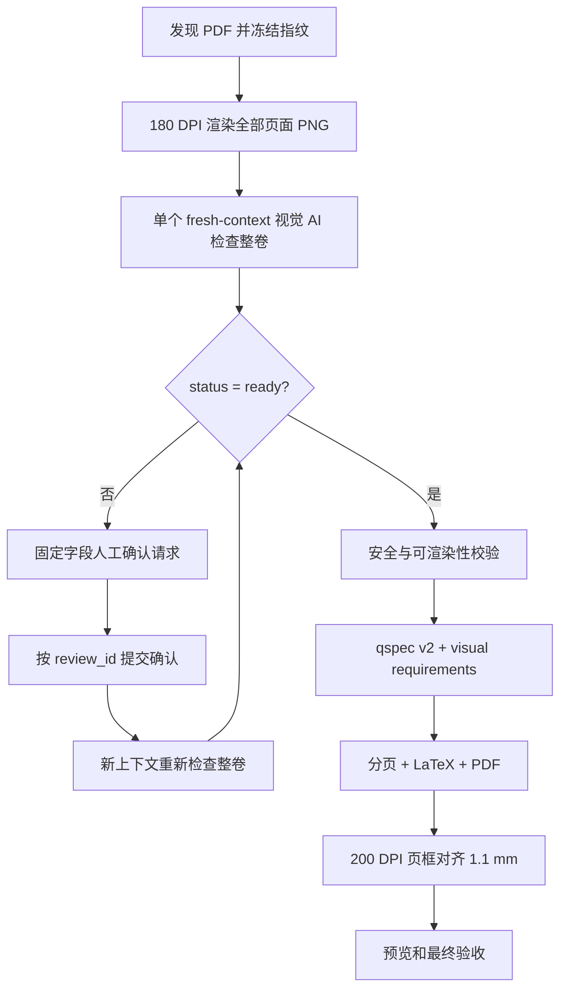

# Answer Card Skill v0.4.0

[English](README.en.md)

本项目用 Python、Jinja2 和 XeLaTeX 生成不含答案内容的空白答题卡。v0.4.0 取消 PDF 文本层、OCR 和正则题号抽取：每份试卷由一个 fresh-context 视觉 AI 按页检查整卷，并一次给出结构、分值占比、答题空间和配图需求。

> v0.4.0 已完成冲突卷整卷视觉验收、A4 成品检查和自动化回归；视觉 AI 仍须具备直接检查全部页面的能力。

## 安全边界

参考答案页只能瞬时用于判断无答案结构和答题空间。任何正式或审计产物都不得包含答案、解答、推理、方程正文、化学结构、页面文字摘录、关键词、自由证据或视觉描述。

允许持久化的内容限于题号、简短安全标题、大题分值、整数占比、来源页、题型、框高和固定枚举配图分类。

## 工作流



脚本不会检查 AI 显示题号是否重复、连续、符合数字顺序或层级，也不会用另一份 outline、OCR 或正则结果否决 AI。qspec v2 生成唯一机器键 `q001`、`q001-i001`，页面只打印 AI 的 `display_id`。

## 批处理命令

```powershell
python scripts/batch_pipeline.py prepare INPUT OUTPUT_ROOT
python scripts/batch_pipeline.py status RUN\batch_manifest.json
python scripts/batch_pipeline.py accept-ai-paper RUN\batch_manifest.json PAPER_ID ATTEMPT_JSON
python scripts/batch_pipeline.py confirm-ai-paper RUN\batch_manifest.json PAPER_ID CONFIRMATION_JSON
python scripts/batch_pipeline.py build RUN\batch_manifest.json --paper PAPER_ID
python scripts/batch_pipeline.py report RUN\batch_manifest.json
```

默认最多进行 3 次页框校正。已由无答案测量历史确认属于慢收敛的单卷，可显式使用 `build ... --max-alignment-passes 4`；非默认上限会写入任务报告，`1.1mm` 验收标准保持不变。

`prepare` 只扫描输入目录第一层 PDF，冻结 SHA-256，并以 180 DPI 输出稳定命名的 `page-001.png` 等临时视觉证据。它不读取 PDF 文本层，不运行 OCR，不生成 outline、skeleton、页面文字或题号候选。

视觉 worker 只能写 job 的 `allowed_output_path`。`needs_human_review` 不消耗一次自动 JSON 重试；确认后创建不可变 revision，新上下文从整卷页面重新生成完整结果。所有卷达到 `validated` 或 `failed` 后，`report` 才生成一次正式任务报告。

## 主要数据契约

| 文件 | 用途 |
| --- | --- |
| `ai_paper_job.revision-R.attempt-N.json` | 固定 prompt、整卷页面、可选确认文件和唯一输出路径 |
| `ai_paper_spec.json` | 唯一的整卷结构、布局和配图事实来源 |
| `human_review.revision-R.json` | 固定字段人工确认请求 |
| `human_confirmation.revision-R.json` | 只含 `review_id` 与确认值的不可变输入 |
| `qspec.yaml` | qspec v2 可审计渲染规范；机器键与显示题号分离 |
| `visual_requirements.json` | 机器键、显示题号和固定配图分类 |
| `pipeline_report.json` | 尝试/revision、占比合计、fallback、构建和对齐审计 |

完整字段见 [数据契约](docs/data-contracts.md)，调度和恢复见 [Codex 批处理编排](references/codex-batch-orchestration.md)。

## 模型能力

结构判断需要能直接查看全部页面图像的视觉模型或可信视觉工具。纯文本模型可以运行确定性阶段，但不得声称整卷视觉结构判断完成。GPT-5.5 和 GPT-5.6 是开发来源记录，不构成厂商锁定或其他模型兼容保证。

## 构建与验证

项目仍使用 A4、XeLaTeX、整块分页、底部居中页码和配图绑定。页框对齐在 200 DPI 检测，默认容差为 1.1 mm，保留 pass 0 和每次校正记录。

唯一支持的测试入口：

```powershell
python scripts/run_tests.py
```

测试入口自动设置本仓库 `src`、使用 GUID 临时目录并验证清理。真实试卷前向验证必须只记录无答案结构元数据。

## 目录

- `src/answercard/ai_paper_schema.py`：整卷 AI 与人工确认 schema。
- `src/answercard/ai_paper_to_qspec.py`：稳定机器键和 qspec v2。
- `scripts/batch_pipeline.py`：可恢复批处理入口。
- `prompts/ai_paper_visual_extract.md`：固定整卷视觉 prompt。
- `tex/`：首页和正文模板。
- `tests/`：安全、schema、兼容和流程测试。

项目许可证见 [LICENSE](LICENSE)。
