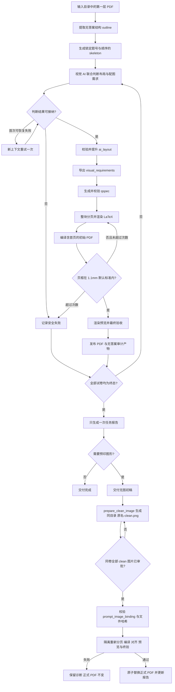

# answer-card-skill

简体中文 | [English](README.en.md)

一个面向化学竞赛等结构化试卷的空白答题卡生成项目。它使用 Python 管理可审计的数据契约，以 LaTeX 生成 A4 PDF，并将结构提取、AI 视觉判断、分页、编译、预览和最终验收明确分开。

> [!IMPORTANT]
> 参考答案 PDF 只允许用于判断题目结构和答题空间需求。项目不得复制、转述、保存或输出答案正文、最终答案、解析、答案图形或其他答题内容。

## 项目特点

- 从任意命名的第一层 PDF 目录生成一批空白答题卡。
- 使用 `outline.json`、`ai_layout.json` 和 qspec 形成可审计的中间层。
- 层级题号只为实际叶子分问生成答题块，并在后续 schema 中拒绝父子 ID 共存。
- 由具备视觉能力的 AI 判断答题块类型、高度和题目配图需求。
- 使用 Jinja2 和 XeLaTeX 确定性生成首页、答题区和页码。
- 自动进行整块分页、页框对齐、页面预览和最终产物校验。
- 输出不含答案内容的流水线报告和任务级 Markdown 总览。
- 当题目需要预印图形时，先交付无图初稿；通过独立 CLI 确定性生成同目录 clean 图片，整卷获批后再由严格 manifest 处理 clean/获准原图、固定定位、取消项或结构覆盖，验证后才原子发布。

## 当前成熟度

当前版本为 `v0.2.0`。2026-07-15 已完成一份真实试卷的单卷全流程验证，层级题号修复、12 页 PDF 构建、预览、`1.1 mm` 页框对齐和最终验收均通过。页框对齐仍以 `200 DPI` 测量。项目目前是可运行的工程版本，Codex 托管的目录批处理流程、确定性 clean 图片准备和审批后统一配图均已实现。版本变化见[变更日志](CHANGELOG.md)。

经人工批准后的可审计配图绑定已实现。当前仍需重点完成：

1. 使用新的 `1.1 mm` 默认页框对齐标准重新验证 19 份批量样本。
2. 继续加强中断恢复、跨平台和不同视觉模型/Agent 宿主的兼容测试。
3. 在生产契约稳定后完成正式 Skill 打包。

详细状态与后续计划见[人类界面与 AI Agent 界面建设路线图](docs/dual-interface-roadmap.md)。

## 快速开始

### 环境要求

- Python 3.11 或更高版本
- XeLaTeX，可通过系统 `PATH` 调用
- 项目 Python 依赖：`jinja2`、`pillow`、`pypdf`、`pyyaml`、`pytest`
- PDF 页面预览：PyMuPDF
- AI 布局阶段：能够直接检查渲染后 PDF 页面的视觉模型或可信视觉工具

Windows PowerShell 示例：

```powershell
git clone https://github.com/RayLuren/answer-card-skill.git
cd answer-card-skill
python -m venv .venv
.\.venv\Scripts\python -m pip install -e .
.\.venv\Scripts\python -m pip install pymupdf
```

### 通过 Codex 处理一个 PDF 目录

在 Codex 中使用类似请求：

```text
调用 <本地 answer-card-skill 项目目录>，
处理 <输入目录> 下的答案 PDF，
输出到 <输出根目录>。
```

产品入口是 `scripts/batch_pipeline.py`。它只扫描输入目录第一层的 `*.pdf`，稳定分配 `paper001`、`paper002` 等内部编号，并创建不覆盖旧结果的 `run-*` 目录。Codex 端的并发与重试规则见 [Codex 批量调度合同](references/codex-batch-orchestration.md)。

### 构建内置示例

```powershell
.\.venv\Scripts\python scripts\build.py spec\qspec.sample.yaml
.\.venv\Scripts\python scripts\render_pages.py build\answercard.pdf build\pages
```

完整安装、单份流程和批处理命令见[快速开始](docs/getting-started.md)与[使用指南](docs/user-guide.md)。

## 工作流概览

流程主体是线性的，只有 AI 视觉复查和 PDF 页框对齐允许受控反馈。



更完整的阶段职责和产物说明见[工作流说明](docs/workflow.md)。

## 主要输出

| 产物 | 作用 |
| --- | --- |
| `outline.json` | 题号、章节、分值和来源页等无答案结构 |
| `ai_layout.json` | 经校验的答题块布局和固定配图分类 |
| `visual_requirements.json` | 是否需要预印题面图形的确定性投影 |
| `qspec.draft.yaml` | 可人工审计的答题卡规格 |
| `prompt_image_binding.json` | 整卷获批 clean/原图、双重哈希、取消项、结构覆盖与固定定位 |
| `qspec.binding.yaml` | 保留原 qspec 后生成的框高调整审计副本 |
| `answercard.tex` / `answercard.pdf` | LaTeX 源文件和空白答题卡 PDF |
| `pages/page-*.png` | 最终 PDF 的逐页预览 |
| `pipeline_report.json` | 单份试卷的无答案验收记录 |
| `task-report.md` | 当前任务唯一的用户级汇总报告 |

## 文档

| 文档 | 内容 |
| --- | --- |
| [文档导航](docs/README.md) | 按用户、开发者和 Agent 角色查找文档 |
| [快速开始](docs/getting-started.md) | 安装、依赖检查和首次构建 |
| [使用指南](docs/user-guide.md) | 单份、批量、恢复和人工配图流程 |
| [工作流说明](docs/workflow.md) | 各阶段职责、反馈环和文件流转 |
| [数据契约](docs/data-contracts.md) | outline、AI layout、visual requirements 和 qspec |
| [验收与报告](docs/validation-and-reporting.md) | 页框对齐、finalize、计时和任务报告 |
| [开发指南](docs/development.md) | 目录结构、测试方式和开发边界 |
| [变更日志](CHANGELOG.md) | 版本号、发布日期和用户可见变化 |
| [长期路线图](docs/dual-interface-roadmap.md) | 人类界面、Agent 界面和跨平台方向 |
| [Codex 批量调度合同](references/codex-batch-orchestration.md) | Codex worker、并发、接纳和重试规则 |

## 安全边界

允许持久化的信息仅限题号、章节边界、题型、主问题分值、页码、答题空间估计和固定结构标签。禁止在 LaTeX、PDF、JSON、YAML、日志、测试、fixture、快照或文档中保存答案正文、最终答案、解释、方程摘录或答案图形。

已完成答案图形不得被裁剪或重建为干净的题面素材。来源不明确时必须标为 `uncertain`，之后只能使用题目卷或其他经人工批准的题面侧来源。

详见[数据契约](docs/data-contracts.md)和[开发指南](docs/development.md)。

## 开发与测试

项目测试只能通过受支持的入口运行：

```powershell
.\.venv\Scripts\python scripts\run_tests.py
```

该入口为每次 pytest 执行创建独立的系统临时目录，并在成功或失败后执行清理；清理失败会明确导致命令失败。贡献代码前请阅读 [CONTRIBUTING.md](CONTRIBUTING.md)。

## 模型与平台说明

确定性的 Python、schema、LaTeX、PDF 编译和预览阶段不绑定模型厂商。AI 布局阶段必须真实具备页面视觉检查能力；仅文本模型不得声称已经完成视觉判断。

GPT-5.5 和 GPT-5.6 是开发过程中使用过的模型，只代表开发来源，不构成供应商锁定或兼容性保证。

## 许可证

本项目采用 [MIT License](LICENSE)。
